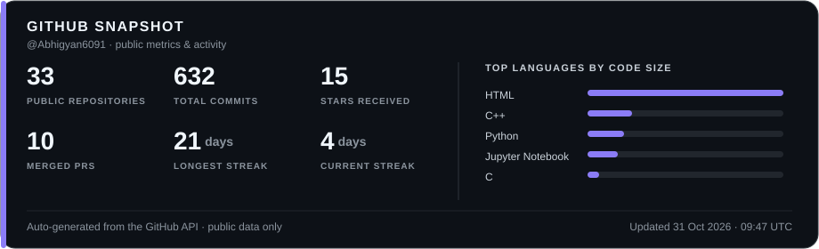

  
  
  
  

**Building AI systems that are useful, observable, and reliable.**

---

## 👋 About Me

I'm a **Data Science & AI undergraduate at IIT Bhilai** interested in the engineering behind intelligent systems—not just model demos.

- 🤖 **Agentic AI:** multi-agent orchestration, tool calling, MCP, evaluation, and human-in-the-loop controls.
- 🔎 **LLM applications:** RAG, hybrid retrieval, local inference, and natural-language interfaces to data.
- ⚙️ **Backend & data systems:** APIs, asynchronous workflows, databases, containerized services, and data pipelines.
- 🧪 **ML research & experimentation:** deep learning, computer vision, sequence models, and reproducible evaluation.

I like projects where model quality meets systems engineering: measurable evaluations, explicit failure handling, traceability, and deployment constraints.

## 🚀 Featured Projects

### 🎓 [Shiksha Sarthi — Offline-First Learning Platform](https://github.com/Abhigyan6091/ShikshaSarthi)
An offline-first school learning, assessment, and grading platform that runs on a local school server, keeping day-to-day classroom workflows available when internet connectivity is unreliable. When connectivity returns, controlled cloud sync supports backups, multi-school updates, and central question-bank updates.

- **Highlights:** Local-first classroom workflows, bidirectional AWS sync, and checksum-verified app updates designed to protect school data.
- **Built with:** React, TypeScript, Vite, Node.js, Express, MongoDB, Docker, AWS, Nginx.

### ⚒️ [ToolForge — Agent Tool Infrastructure & MCP Platform](https://github.com/Abhigyan6091/ToolForge)
A secure execution gateway for AI agents that manages the full tool-call lifecycle: discovery, JSON Schema validation, capability-based RBAC, sandboxed execution, retries, timeouts, and structured observability. It exposes tools through MCP, REST, LangGraph, and OpenAI function-calling adapters.

- **Highlights:** 26 standard tools, 86 tests reported by the repository, and CI coverage across multiple operating systems and Python versions.
- **Built with:** Python, FastAPI, Pydantic, SQLAlchemy, PostgreSQL, Redis, Docker, MCP, LangGraph, Prometheus.

### 🛰️ [Autonomous Engineering Intelligence Platform (AEIP)](https://github.com/Abhigyan6091/Autonomous-Engineering-Intelligence-Platform)
An AI software-reliability system that autonomously investigates incidents across code, logs, metrics, Git history, and tests; builds evidence-backed hypotheses; challenges findings through a Critic agent; and recommends remediations with human approval and audit provenance.

- **Evaluation:** 92.3% root-cause accuracy on a 10-incident benchmark; live-run evidence recall of 0.75.
- **Built with:** Python, LangGraph, FastAPI, Next.js, PostgreSQL, Redis, Qdrant, Docker.

### 💳 [Fraud Detection — AI Risk Manager](https://github.com/Abhigyan6091/Fraud-Detection)
A merchant-focused fraud decisioning system that goes beyond fraud probability by estimating expected financial loss, detecting attack episodes, explaining decisions, and choosing whether to approve, verify, or block a transaction based on cost.

- **Held-out evaluation:** On 439,813 transactions, the repository reports 99.0% of modeled fraud exposure prevented, 204 false declines, and PR-AUC of 0.9701. Results are specific to the documented public-dataset evaluation and cost assumptions.
- **Built with:** Python, XGBoost, Isolation Forest, SHAP, feature engineering, expected-loss decisioning, data analysis.

### 🛡️ [WinGuard — Adaptive Windows Process Isolation](https://github.com/Abhigyan6091/WinGuard-Framework)
A native Windows security framework that applies kernel-enforced isolation to untrusted processes and adapts CPU, memory, and process limits as runtime behavior changes. Suspended process launch helps ensure containment is applied before the process begins executing.

- **Highlights:** Windows Job Objects, restricted access tokens, low-integrity labels, isolated workspaces, high-frequency telemetry, and an adaptive escalation-and-recovery state machine. The repository reports a 79.2% resident-memory reduction in its LEVEL 2 benchmark.
- **Built with:** C, Win32 API, Windows security primitives, process monitoring, CSV telemetry.

### 🧿 [Sentinel-Aegis — AI Application Security & Red Teaming](https://github.com/Abhigyan6091/Sentinel-Aegis)
A local AI application security platform for exercising and observing defenses against prompt injection, jailbreaks, RAG poisoning, tool abuse, and data leakage. It brings runtime guardrails, context-firewall checks, tool authorization, red-team campaigns, findings, and security scoring into one workflow.

- **Highlights:** Tenant-aware backend APIs, persisted traces and campaign results, Prometheus metrics, Grafana dashboards, and a deterministic adversarial CI security gate.
- **Built with:** Python, FastAPI, Next.js, PostgreSQL, Redis, Qdrant, Redpanda, Prometheus, Grafana, Docker Compose.

[Explore all my repositories →](https://github.com/Abhigyan6091?tab=repositories) · [View my portfolio →](https://abhigyan6091.github.io/Portfolio/)

## 🧰 Technical Toolkit

| Area | Technologies & concepts |
|---|---|
| **Languages** | Python, C++, C, Java, JavaScript, TypeScript, SQL |
| **ML & Computer Vision** | PyTorch, TensorFlow, scikit-learn, Hugging Face Transformers, OpenCV, CNNs, ViTs, GANs |
| **LLM & Agent Systems** | LangChain, LangGraph, RAG, hybrid retrieval, MCP, tool calling, prompt/evaluation design, Ollama |
| **Backend & Web** | FastAPI, Flask, Django REST Framework, Node.js, Express, React, Next.js, REST APIs, asynchronous services |
| **Databases & Retrieval** | PostgreSQL, MySQL, MongoDB, Redis, Qdrant, FAISS, vector search, BM25 |
| **Data Engineering** | ETL/ELT, Apache Airflow, Apache Spark, Kafka, data lineage, feature engineering |
| **Cloud & Engineering** | Docker, Docker Compose, AWS, Git, Linux, GitHub Actions, CI/CD, testing, observability |
| **Core CS** | Data structures & algorithms, OOP, DBMS, operating systems, computer networks, system design |

## 📊 GitHub Snapshot

<!-- This SVG is generated and committed by .github/workflows/update-github-stats.yml. -->

  

The stats card is generated by a GitHub Actions workflow in this repository. It uses GitHub's API and stores the result here, so your profile does not rely on a public third-party stats-card host. It refreshes daily; you can also run the workflow manually from the **Actions** tab.

## 🤝 Let’s Connect

I'm interested in AI/ML engineering, GenAI infrastructure, backend and data engineering, and research-oriented projects. Feel free to reach out if you'd like to discuss a technical idea or collaborate.

  <i>“Build systems that scale, models that reason, products that matter.”</i>

